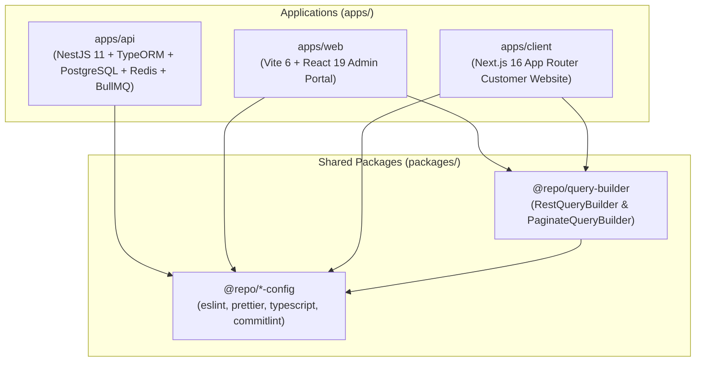

# Monorepo Master Developer Guide

This document defines the overarching architectural principles, workspace boundaries, development workflows, and coding standards for this enterprise full-stack monorepo.

---

## 1. Monorepo Topology & Boundaries



### Workspace Responsibility Matrix

| Workspace                                                      | Type        | Core Technologies                                                        | Primary Responsibility                                                                                                                                 |
| :------------------------------------------------------------- | :---------- | :----------------------------------------------------------------------- | :----------------------------------------------------------------------------------------------------------------------------------------------------- |
| **[`apps/api`](file:///apps/api)**                             | Application | NestJS 11, TypeORM, PostgreSQL 16, Redis 7, BullMQ, Swagger, Sentry      | Core REST API backend. Handles persistence, authentication, authorization (RBAC), background queue processing, and email dispatching.                  |
| **[`apps/web`](file:///apps/web)**                             | Application | Vite 6, React 19, Tailwind CSS v4, TanStack Query, Radix UI, Tiptap      | Administrative portal. Provides rich interactive data tables, entity forms, drag-and-drop sortable lists, theme editors, and file managers.            |
| **[`apps/client`](file:///apps/client)**                       | Application | Next.js 16 (App Router), React 19, Turbopack, Tailwind CSS v4, next-intl | Customer-facing web application. Optimized for SEO (metadata), fast SSR/SSG rendering via React Server Components, and multi-language i18n.            |
| **[`packages/query-builder`](file:///packages/query-builder)** | Package     | TypeScript, Vitest                                                       | Type-safe query builder library providing `RestQueryBuilder` (for JSON:API/REST whitelist queries) and `PaginateQueryBuilder` (for `nestjs-paginate`). |
| **`packages/*-config`**                                        | Configs     | ESLint 9/10, Prettier, TypeScript, Commitlint                            | Standardized code style, linting rules, type-checking baselines, and commit message conventions.                                                       |

---

## 2. Package Management & Task Orchestration

### Package Manager Rules

- **Use `pnpm` exclusively (pinned v10.30.3)**: Never run `npm` or `yarn`.
- **Single Root Lockfile**: Maintain exactly one `pnpm-lock.yaml` at the repository root. Never generate nested lockfiles inside `apps/` or `packages/`.
- **Managing Workspace Dependencies**:
  ```bash
  # Add dependency to a specific workspace
  pnpm --filter api add @nestjs/passport
  pnpm --filter web add lucide-react
  pnpm --filter client add next-intl

  # Add workspace package as internal dependency
  pnpm --filter web add @repo/query-builder@workspace:*
  pnpm --filter client add @repo/query-builder@workspace:*

  # Add root dev dependency (tooling only)
  pnpm add -D -w prettier
  ```

### Turborepo Orchestration (`turbo.json`)

Tasks across all workspaces are coordinated by Turborepo:

| Command            | Scope & Action                                                       |
| :----------------- | :------------------------------------------------------------------- |
| `pnpm dev`         | Starts all development servers concurrently (`api`, `web`, `client`) |
| `pnpm build`       | Executes cached production builds for all workspaces                 |
| `pnpm lint`        | Runs ESLint across all applications and packages                     |
| `pnpm check-types` | Executes static type checking (`tsc --noEmit`) across all workspaces |
| `pnpm test`        | Runs unit and integration test suites via Vitest and Jest            |
| `pnpm clean`       | Purges build caches (`dist`, `.turbo`, `.next`)                      |

---

## 3. End-to-End Feature Development Workflow

When introducing a new domain feature (e.g., `articles`, `products`, `invoices`), follow this structured 7-step lifecycle:

### Step 1: Database Entity & Migration (`apps/api`)

1. Create the TypeORM entity in `apps/api/src/api/<feature>/entities/<feature>.entity.ts`.
2. Generate and run the TypeORM migration:
   ```bash
   pnpm --filter api migration:generate src/database/migrations/<FeatureName>
   pnpm --filter api migration:run
   ```
3. Never use TypeORM `synchronize: true` in production. Always use migrations.

### Step 2: DTOs & Validation Decorators (`apps/api`)

1. Define request DTOs in `apps/api/src/api/<feature>/dto/`.
2. Decorate every field with `class-validator` (`@IsString()`, `@IsNotEmpty()`, `@IsOptional()`, `@IsEnum()`) and `class-transformer` (`@Type()`).
3. Annotate Swagger `@ApiProperty()` on all DTO fields.

### Step 3: Domain Service & QueryBuilder (`apps/api`)

1. Implement business logic in `apps/api/src/api/<feature>/<feature>.service.ts`.
2. Use TypeORM `EntityManager` or `QueryRunner` for atomic multi-table write transactions.
3. For list queries, use the monorepo `QueryBuilder`:
   ```typescript
   import { QueryBuilder, AllowedFilter, QueryParams } from "@/common/query-builder";

   async findAll(query: QueryParams) {
     return QueryBuilder.for(this.repository, query)
       .allowedFilters([
         AllowedFilter.partial("title"),
         AllowedFilter.exact("status"),
         AllowedFilter.trashed(),
       ])
       .allowedSorts(["createdAt", "title"])
       .defaultSort("-createdAt")
       .allowedIncludes(["author", "category"])
       .paginate();
   }
   ```

### Step 4: API Controller & Swagger Documentation (`apps/api`)

1. Secure endpoints with JWT auth and permissions (`@RequirePermission(...)`).
2. Document query parameters using `@ApiQueryBuilderDocs`:
   ```typescript
   @Get()
   @ApiQueryBuilderDocs({
     entity: ArticleDto,
     filters: ["title", AllowedFilter.exact("status"), AllowedFilter.trashed()],
     sorts: ["createdAt", "title"],
     defaultSort: "-createdAt",
     includes: ["author", "category"],
   })
   findAll(@Query() query: QueryParams) {
     return this.service.findAll(query);
   }
   ```

### Step 5: Shared Query Building (`@repo/query-builder`)

Frontends construct query strings using `RestQueryBuilder`:

```typescript
import { RestQueryBuilder } from "@repo/query-builder";

const queryString = new RestQueryBuilder()
  .filter("status", "ACTIVE")
  .sortBy("createdAt", "desc")
  .include("author", "category")
  .paginate(1, 20)
  .toQueryString();
```

### Step 6: Admin Portal UI (`apps/web`)

1. Create React Query hooks in `apps/web/src/pages/<feature>/queries.ts` with typed query keys.
2. Render list views using the reusable `DataTable` component.
3. Build create/edit forms using **React Hook Form** + **Zod** schema validation.
4. Notify users upon submission success or error using **Sonner** toasts.

### Step 7: Customer Website (`apps/client`)

1. Render pages as **React Server Components (RSC)** by default in `apps/client/src/app/[locale]/<feature>/`.
2. Push `"use client"` directives down to leaf components only when interactivity (hooks, state, event handlers) is strictly needed.
3. Export proper SEO metadata via `generateMetadata()` or static `metadata` object.
4. Define translation keys in `apps/client/messages/en.json` and `apps/client/messages/vi.json` using `next-intl`.

---

## 4. Cross-Cutting Engineering Standards

### Frontend & UI Rules

- **Unified Radix UI**: Import primitives directly from `"radix-ui"` (e.g., `import { Dialog, Slot, Tooltip } from "radix-ui"`). Do **NOT** install individual `@radix-ui/react-*` packages.
- **Form Management**: ALWAYS use **Zod** schema validation combined with **React Hook Form** via shadcn form components for ALL forms. Never rely on unvalidated raw inputs.
- **State Management**:
  - Use **TanStack React Query** for all server API state, mutations, caching, and invalidation.
  - Use **Zustand** only for client-side transient UI/session state (e.g., sidebar collapse, modals, active themes).
- **Internationalization (i18n)**:
  - Never hardcode user-facing UI text strings.
  - In `apps/client`, use `useTranslations()` from `next-intl`.
  - In `apps/web`, use `useTranslation()` from `react-i18next`.
- **Image Optimization**: Always use Next.js `<Image />` from `next/image` in `apps/client` for WebP/AVIF responsive loading. Never use native `` tags.
- **Error Feedback**: Never swallow exceptions silently in empty catch blocks. Always inform users of API failures using **Sonner** toasts or inline form errors.

### Backend & API Rules

- **Modular NestJS Architecture**: Place domain modules inside `apps/api/src/api/<feature-name>`. Strictly separate Controllers, Services, DTOs, and TypeORM entities.
- **Exception Handling**: Always throw explicit NestJS HTTP exceptions (`BadRequestException`, `NotFoundException`, `ConflictException`, `ForbiddenException`). Never leak raw SQL errors or internal database traces to clients.
- **Logging**: Use NestJS `Logger` service (`new Logger(Service.name)`). Never use `console.log`.
- **N+1 Query Prevention**: Always use `allowedIncludes`, explicit joins, or relation loaders. Never execute queries inside loops.
- **QueryBuilder Whitelists**: Every list endpoint must declare explicit `allowedFilters`, `allowedSorts`, `allowedIncludes`, and `maxLimit` (default: 100) to protect against SQL injection and DoS attacks.

### Language & Documentation Standards

- **Zero Vietnamese Comments in Code**: All code comments, JSDoc annotations (`@param`, `@returns`, `@example`), and variable names must be written in **professional English**.
- **Preserve Documentation**: Maintain documentation integrity when modifying existing files. Do not delete existing comments unrelated to your changes.

---

## 5. Git Workflow & Release Conventions

### Conventional Commits

Commit messages must strictly follow the Conventional Commits format:

```
<type>(<scope>): <subject>
```

- **Allowed Types**: `feat`, `fix`, `refactor`, `docs`, `style`, `test`, `perf`, `chore`, `ci`, `build`.
- **Allowed Scopes**: Target workspace or component (e.g., `api`, `web`, `client`, `query-builder`, `ui`, `auth`).
- **Subject Length**: Maximum **100 characters** enforced by Commitlint.

Example:

```bash
git commit -m "feat(api): implement user activity log export"
```

### Release Automation

Releases and automated semantic versioning tags (`vX.Y.Z`) are managed by **Semantic Release** on GitHub Actions. Refer to [`docs/RELEASE.md`](file:///docs/RELEASE.md) for full release guidelines.

---

## 6. Pre-Commit Verification Checklist

Before committing changes or opening a Pull Request, verify:

1. `pnpm check-types`: All TypeScript projects pass with 0 errors.
2. `pnpm lint`: All ESLint rules pass with 0 warnings.
3. `pnpm test`: All unit and integration tests pass.
4. `pnpm build`: Monorepo builds successfully across all applications.
5. No Vietnamese comments exist in new or modified source code files.
6. Commit message follows Conventional Commits format and header is $\le 100$ characters.
