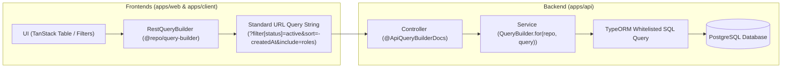

# Monorepo QueryBuilder Skill

This skill provides comprehensive patterns, architectural conventions, and best practices for implementing and consuming list APIs using the unified QueryBuilder system across the monorepo.

---

## 1. System Architecture & End-to-End Flow



The system is designed around **strict whitelist enforcement**:

- The frontend builds standard, readable query parameters using `RestQueryBuilder`.
- The backend verifies every filter, sort, include, and field against an explicit whitelist before applying it to the database query.
- Any unauthorized parameter is safely ignored or rejected with a clean `400 Bad Request` in strict mode.

---

## 2. Backend Implementation (`apps/api`)

All backend QueryBuilder components reside in [`apps/api/src/common/query-builder/`](file:///apps/api/src/common/query-builder/):

- `QueryBuilder`: Core builder class.
- `AllowedFilter`: Filter condition declarations.
- `AllowedSort`: Sort direction declarations.
- `AllowedInclude`: Relationship eager loading declarations.
- `ApiQueryBuilderDocs`: OpenAPI/Swagger documentation decorator.

### A. Controller Definition with Swagger Decorators

Always annotate list endpoints with `@ApiQueryBuilderDocs` or `@ApiAuth({ isQueryBuilder: true })` to provide automatic Swagger documentation:

```typescript
import { Controller, Get, Query } from "@nestjs/common";
import {
  ApiQueryBuilderDocs,
  AllowedFilter,
  QueryParams,
} from "../common/query-builder";
import { UserDto } from "./dto/user.dto";
import { UserService } from "./user.service";

@Controller("users")
export class UserController {
  constructor(private readonly userService: UserService) {}

  @Get()
  @ApiQueryBuilderDocs({
    entity: UserDto,
    filters: [
      "name",
      "email",
      AllowedFilter.exact("status"),
      AllowedFilter.exact("role.id"),
      AllowedFilter.trashed(),
    ],
    sorts: ["createdAt", "name", "email"],
    defaultSort: "-createdAt",
    includes: ["roles", "profile"],
    fields: ["id", "name", "email", "status"],
    defaultLimit: 20,
    maxLimit: 100,
  })
  async findAll(@Query() query: QueryParams) {
    return this.userService.findAll(query);
  }
}
```

### B. Service Implementation

Use `QueryBuilder.for(repository, query)` to construct the database query:

```typescript
import { Injectable } from "@nestjs/common";
import { InjectRepository } from "@nestjs/typeorm";
import { Repository } from "typeorm";
import {
  QueryBuilder,
  AllowedFilter,
  QueryParams,
} from "../common/query-builder";
import { UserEntity } from "./entities/user.entity";

@Injectable()
export class UserService {
  constructor(
    @InjectRepository(UserEntity)
    private readonly userRepository: Repository<UserEntity>,
  ) {}

  async findAll(query: QueryParams) {
    return QueryBuilder.for(this.userRepository, query)
      .allowedFilters([
        // Partial search (ILIKE '%value%')
        AllowedFilter.partial("name"),
        AllowedFilter.partial("email"),
        // Exact match or array IN match
        AllowedFilter.exact("status"),
        // Relation filter using dot notation
        AllowedFilter.exact("roles.id"),
        // Soft-delete filter ('with', 'only', 'without')
        AllowedFilter.trashed(),
        // Custom scope filter callback
        AllowedFilter.callback("search", (qb, value) => {
          qb.andWhere("(user.name ILIKE :search OR user.email ILIKE :search)", {
            search: `%${value}%`,
          });
        }),
      ])
      .allowedSorts([
        "createdAt",
        "name",
        "email",
        // Nested relation sorting
        "roles.name",
      ])
      .defaultSort("-createdAt")
      .allowedIncludes([
        "roles",
        "profile",
        // Nested relation inclusion
        "profile.avatar",
        // Relation count
        "rolesCount",
      ])
      .allowedFields([
        "id",
        "name",
        "email",
        "status",
        "createdAt",
        "roles.id",
        "roles.name",
      ])
      .paginate(); // Executes query and returns { data, meta: { total, page, limit, totalPages } }
  }
}
```

### C. Available Filter Operators

| Method                             | Target Parameter       | SQL Behavior                                     | Example URL                                      |
| :--------------------------------- | :--------------------- | :----------------------------------------------- | :----------------------------------------------- |
| `AllowedFilter.exact(name)`        | `filter[name]=value`   | `= :value` or `IN (:...value)`                   | `?filter[status]=active` or `?filter[roles]=1,2` |
| `AllowedFilter.partial(name)`      | `filter[name]=value`   | `ILIKE '%value%'`                                | `?filter[name]=john`                             |
| `AllowedFilter.startsWith(name)`   | `filter[name]=value`   | `ILIKE 'value%'`                                 | `?filter[code]=PRJ-`                             |
| `AllowedFilter.endsWith(name)`     | `filter[name]=value`   | `ILIKE '%value'`                                 | `?filter[domain]=.com`                           |
| `AllowedFilter.operator(name)`     | `filter[name]=$gt:10`  | Comparison (`$gt`, `$gte`, `$lt`, `$lte`, `$ne`) | `?filter[age]=$gte:18`                           |
| `AllowedFilter.trashed()`          | `filter[trashed]=with` | Soft deletes: `with`, `only`, `without`          | `?filter[trashed]=only`                          |
| `AllowedFilter.callback(name, fn)` | `filter[name]=value`   | Custom query builder callback                    | `?filter[search]=term`                           |

---

## 3. Frontend Implementation (`apps/web` & `apps/client`)

Frontend applications use the shared [`@repo/query-builder`](file:///packages/query-builder) package. Re-exported aliases are available at `@/lib/query-builder`.

### A. Using `RestQueryBuilder`

The `RestQueryBuilder` provides a chainable, fluent API that outputs URL strings matching the backend specification:

```typescript
import { RestQueryBuilder } from "@repo/query-builder";
// or: import { RestQueryBuilder } from "@/lib/query-builder";

const queryString = new RestQueryBuilder()
  // Filters: filter[status]=ACTIVE&filter[role]=ADMIN,MANAGER
  .filter("status", "ACTIVE")
  .filter("role", ["ADMIN", "MANAGER"])
  // Suffix/prefix/exact match
  .filterExact("type", "INTERNAL")
  // Soft deletes: filter[trashed]=with
  .filterTrashed("with")
  // Sorts: sort=-createdAt,title (prefix '-' denotes descending)
  .sortBy("createdAt", "desc")
  .sortBy("title", "asc")
  // Includes: include=roles,profile
  .include("roles", "profile")
  // Sparse Fieldsets: fields[user]=id,name,email
  .fieldsFor("user", ["id", "name", "email"])
  // Global search: q=keyword
  .search("keyword")
  // Pagination: page=1&limit=20
  .paginate(1, 20)
  // Build encoded query string
  .toQueryString();
```

### B. Integration with TanStack React Query (`@tanstack/react-query`)

Wrap the API call in a reusable query hook with typed query params:

```typescript
import { useQuery } from "@tanstack/react-query";
import { RestQueryBuilder } from "@/lib/query-builder";
import { api } from "@/lib/api";

export interface UserListParams {
  page?: number;
  limit?: number;
  search?: string;
  status?: string;
  sortBy?: string;
  sortDirection?: "asc" | "desc";
  roles?: string[];
}

export function useUsersList(params: UserListParams) {
  return useQuery({
    queryKey: ["users", "list", params],
    queryFn: async () => {
      const qs = new RestQueryBuilder()
        .paginate(params.page ?? 1, params.limit ?? 20)
        .filter("status", params.status)
        .filter("roles", params.roles)
        .search(params.search)
        .include("roles", "profile");

      if (params.sortBy) {
        qs.sortBy(params.sortBy, params.sortDirection ?? "asc");
      } else {
        qs.sortBy("createdAt", "desc");
      }

      const { data } = await api.get(`/users?${qs.toQueryString()}`);
      return data;
    },
    staleTime: 30_000,
  });
}
```

### C. Integration with TanStack Table (`apps/web`)

Use the dedicated high-level pipelines **`useResourceTable`** (for NestJS Paginate) or **`useRestResourceTable`** (for REST endpoints):

```tsx
import { useMemo } from "react";
import { useRestResourceTable } from "@/hooks/use-rest-resource-table";
import { DataTable } from "@/components/data-table/data-table";
import { DataTableToolbar } from "@/components/data-table/data-table-toolbar";
import { DataTableSortList } from "@/components/data-table/data-table-sort-list";

export function UserTableContainer() {
  const columns = useMemo(() => getUserTableColumns(), []);

  const { table, isFetching } = useRestResourceTable({
    columns,
    allowedSorts: ["name", "createdAt"],
    queryHook: useUsersQuery,
    buildQuery: (builder, filter) => {
      builder.filter("status", filter.status).include("roles");
    },
    getRowId: (row) => row.id,
  });

  return (
    <DataTable table={table} isFetching={isFetching}>
      <DataTableToolbar table={table}>
        <DataTableSortList table={table} />
      </DataTableToolbar>
    </DataTable>
  );
}
```

#### Low-Level Manual Integration (Optional)

Bridge TanStack Table state (`pagination`, `sorting`, `columnFilters`) directly to `RestQueryBuilder`:

```tsx
import { useState, useMemo } from "react";
import {
  PaginationState,
  SortingState,
  ColumnFiltersState,
} from "@tanstack/react-table";
import { RestQueryBuilder } from "@/lib/query-builder";
import { useQuery } from "@tanstack/react-query";
import { api } from "@/lib/api";

export function UserTableContainer() {
  const [pagination, setPagination] = useState<PaginationState>({
    pageIndex: 0,
    pageSize: 20,
  });
  const [sorting, setSorting] = useState<SortingState>([
    { id: "createdAt", desc: true },
  ]);
  const [columnFilters, setColumnFilters] = useState<ColumnFiltersState>([]);
  const [globalFilter, setGlobalFilter] = useState("");

  const queryParams = useMemo(() => {
    const builder = new RestQueryBuilder()
      .page(pagination.pageIndex + 1)
      .limit(pagination.pageSize)
      .search(globalFilter);

    // Apply sorting
    for (const sort of sorting) {
      builder.sortBy(sort.id, sort.desc ? "desc" : "asc");
    }

    // Apply column filters
    for (const filter of columnFilters) {
      builder.filter(filter.id, filter.value);
    }

    return builder.toQueryString();
  }, [pagination, sorting, columnFilters, globalFilter]);

  const { data, isLoading } = useQuery({
    queryKey: ["users", queryParams],
    queryFn: async () => {
      const response = await api.get(`/users?${queryParams}`);
      return response.data;
    },
  });

  // Render DataTable component
  return null;
}
```

---

## 4. Legacy / `nestjs-paginate` Support

For third-party or legacy endpoints using the `nestjs-paginate` library:

```typescript
import { PaginateQueryBuilder } from "@repo/query-builder";
// or: import { NestjsPaginateQueryBuilder } from "@/lib/query-builder";

const queryString = new PaginateQueryBuilder()
  .page(1)
  .limit(20)
  .sortBy("createdAt", "DESC")
  .eq("status", "ACTIVE")
  .in("role", ["ADMIN", "USER"])
  .btw("age", [18, 65])
  .search("john")
  .searchBy(["email", "name"])
  .select(["id", "name", "email"])
  .toQueryString();
```

---

## 5. Security & Best Practice Rules

1. **Always Enforce Whitelists**:
   - Never pass arbitrary client columns to TypeORM queries.
   - Always declare explicit `allowedFilters`, `allowedSorts`, `allowedIncludes`, and `allowedFields`.

2. **DoS Protection**:
   - Enforce pagination limits using `maxLimit` (default: 100) on all list queries. Never allow queries with unbounded page sizes like `limit=999999`.

3. **Prevent N+1 Queries**:
   - When eager loading relations using `allowedIncludes`, ensure entity relations are indexed with proper foreign keys.
   - Use `AllowedInclude.count('relation')` rather than loading full relation entities when only counts are required.

4. **Zero Vietnamese Comments**:
   - Code comments and JSDoc annotations must be written in professional English with proper `@param`, `@returns`, and `@example` tags.

5. **Type Safety & Single Source of Truth**:
   - Do not manually concatenate URL strings with `?filter[status]=` template literals. Always use `RestQueryBuilder` to handle URL encoding, array brackets/commas, and undefined value stripping automatically.
