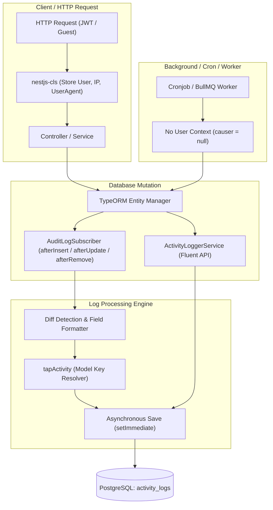

# Activity & Audit Log System for NestJS & TypeORM

> **English** | [Tiếng Việt](ACTIVITY_LOG.vi.md)

A comprehensive, automated, and fluent activity and audit logging architecture for NestJS and TypeORM.

It enables automatic change tracking on TypeORM entities, dynamic diff generation, contextual actor extraction via Continuation Local Storage (`nestjs-cls`), and manual programmatic logging via a fluent builder interface.

---

## Table of Contents

- [Features](#features)
- [Architecture Overview](#architecture-overview)
- [Directory Structure](#directory-structure)
- [Database Schema & Entity](#database-schema--entity)
  - [Entity Definition (`ActivityLogEntity`)](#entity-definition-activitylogentity)
  - [Indices](#indices)
- [Automatic Tracking (`AuditLogSubscriber`)](#automatic-tracking-auditlogsubscriber)
  - [Lifecycle Hooks](#lifecycle-hooks)
  - [Actor & Context Extraction (CLS)](#actor--context-extraction-cls)
  - [Ignored Entities & Excluded Fields](#ignored-entities--excluded-fields)
  - [Empty Changes Suppression (`dontLogEmptyChanges`)](#empty-changes-suppression-dontlogemptychanges)
  - [Dynamic Field Formatting](#dynamic-field-formatting)
  - [Default Model Key Resolution & Tap Activity](#default-model-key-resolution--tap-activity)
- [Entity Customization (`ILogsActivity`)](#entity-customization-ilogsactivity)
  - [Configuring `getActivitylogOptions()`](#configuring-getactivitylogoptions)
  - [Customizing with `tapActivity()`](#customizing-with-tapactivity)
- [Programmatic Logging (`ActivityLoggerService`)](#programmatic-logging-activityloggerservice)
  - [Fluent Builder API](#fluent-builder-api)
  - [Examples](#examples)
- [REST API & Backward Compatibility](#rest-api--backward-compatibility)
  - [Endpoints](#endpoints)
  - [Filtering & Pagination](#filtering--pagination)
  - [Response DTO & Compatibility Aliases](#response-dto--compatibility-aliases)
- [Automated Retention & Cleanup](#automated-retention--cleanup)
- [Testing](#testing)

---

## Features

- **Standardized Schema**: Adopts the standardized schema (`logName`, `description`, `subjectType`, `subjectId`, `causerType`, `causerId`, `properties`, `event`, `batchUuid`).
- **Dual-Mode Logging**:
  1. **Automatic Lifecycle Tracking**: TypeORM `EventSubscriber` captures inserts, updates, deletes, soft-deletes, and recovers without touching service logic.
  2. **Manual Fluent Logging**: Injectable `ActivityLoggerService` allows logging arbitrary domain events, workflows, and batch operations.
- **Context-Aware Actor Resolution**: Seamlessly captures the active user, client IP, User-Agent, and Request ID using `nestjs-cls` (AsyncLocalStorage), while gracefully falling back to `'System'` for cronjobs, BullMQ workers, and guest actions.
- **Zero-Noise Updates (`dontLogEmptyChanges`)**: Prevents redundant log entries when records are saved without actual data modifications.
- **Detailed Diffs with Dynamic Title Formatting**: Tracks granular `{ field, label, from, to }` changes with automatic title casing (e.g. `firstName` $\rightarrow$ `First Name`), eliminating hardcoded translation dictionaries.
- **Entity Extensibility**: Entities can implement `ILogsActivity` to customize logged columns, ignored fields, or completely override description and attributes via `tapActivity`.
- **API & Frontend Backward Compatibility**: Exposes modern activity log fields alongside legacy aliases (`entity`, `action`, `userId`, `oldValue`, `newValue`, `metadata`) so existing client apps operate without disruption.

---

## Architecture Overview



---

## Directory Structure

All audit and activity logging components reside in [`apps/api/src/api/audit-log/`](file:///home/hongphat/Documents/Personal/monorepo/apps/api/src/api/audit-log/):

```
apps/api/src/api/audit-log/
├── activity-logger.service.ts       # Fluent ActivityBuilder & ActivityLoggerService
├── activity-logger.service.spec.ts  # Unit tests for fluent activity logger
├── audit-log.controller.ts          # REST controller (/audit-logs and /activity-logs)
├── audit-log.controller.spec.ts     # Controller unit tests
├── audit-log.module.ts              # NestJS module declaration
├── audit-log.service.ts             # Paginated query service & retention cron
├── audit-log.service.spec.ts        # Service unit tests
├── dto/
│   └── audit-log.res.dto.ts         # Response DTO with standardized schema & legacy aliases
├── entities/
│   └── activity-log.entity.ts       # TypeORM ActivityLogEntity (table: activity_logs)
├── interfaces/
│   └── logs-activity.interface.ts   # ILogsActivity & LogOptions interfaces
└── subscribers/
    ├── audit-log.subscriber.ts      # TypeORM EventSubscriber for automated tracking
    └── audit-log.subscriber.spec.ts # Comprehensive subscriber unit tests
```

---

## Database Schema & Entity

### Entity Definition (`ActivityLogEntity`)

Table: `activity_logs`

| Column         | Type          | Nullable | Description                                                                           |
| :------------- | :------------ | :------: | :------------------------------------------------------------------------------------ |
| `id`           | `bigint`      |    No    | Auto-incrementing primary key                                                         |
| `log_name`     | `varchar`     |    No    | Log category or channel (default: `'default'`)                                        |
| `description`  | `text`        |   Yes    | Human-readable action description (`"{Model}: {identifier}"`)                         |
| `subject_type` | `varchar`     |   Yes    | Model or entity name (e.g. `'AdminUser'`, `'CmsPage'`)                                |
| `subject_id`   | `bigint`      |   Yes    | Primary key of the affected entity                                                    |
| `causer_type`  | `varchar`     |   Yes    | Entity type of the actor (e.g. `'AdminUserEntity'`, `null` for System)                |
| `causer_id`    | `varchar`     |   Yes    | User ID or identifier of the actor                                                    |
| `properties`   | `json`        |   Yes    | Stores `{ attributes, old, changedFields, changes, causer_name, ip, userAgent, ... }` |
| `event`        | `varchar`     |   Yes    | Event name (`'create'`, `'update'`, `'delete'`, `'restore'`)                          |
| `batch_uuid`   | `uuid`        |   Yes    | Optional UUID grouping multiple batch actions together                                |
| `created_at`   | `timestamptz` |    No    | Creation timestamp with timezone (`default: now()`)                                   |
| `updated_at`   | `timestamptz` |    No    | Last update timestamp with timezone (`default: now()`)                                |

### Indices

To ensure optimal query performance when filtering logs:

- `IDX_activity_logs_log_name` on `(log_name)`
- `IDX_activity_logs_subject` on `(subject_type, subject_id)`
- `IDX_activity_logs_causer` on `(causer_type, causer_id)`
- `IDX_activity_logs_event` on `(event)`
- `IDX_activity_logs_batch_uuid` on `(batch_uuid)`
- `IDX_activity_logs_created_at` on `(created_at)`

---

## Automatic Tracking (`AuditLogSubscriber`)

The [`AuditLogSubscriber`](file:///home/hongphat/Documents/Personal/monorepo/apps/api/src/api/audit-log/subscribers/audit-log.subscriber.ts) is registered as a TypeORM `EventSubscriber`. It automatically listens to lifecycle events across all entities.

### Lifecycle Hooks

- `afterInsert(event)`: Emits an activity log with event `'create'`.
- `afterUpdate(event)`: Computes field-level diffs; emits an activity log with event `'update'`.
- `afterRemove(event)`: Emits an activity log with event `'delete'`.
- `afterSoftRemove(event)`: Emits an activity log with event `'delete'`.
- `afterRecover(event)`: Emits an activity log with event `'restore'`.

Saving is dispatched non-blockingly using `setImmediate(() => auditRepo.save(log))` to guarantee zero latency penalty on database writes.

### Actor & Context Extraction (CLS)

The subscriber pulls context from the active `ClsService` instance:

```typescript
const cls = ClsServiceManager.getClsService();
const currentUser = cls.get("user");
const causerId = currentUser?.id ? String(currentUser.id) : null;
const rawUserType = cls.get("userType");
const causerType = causerId ? rawUserType || "AdminUserEntity" : null;
```

- **Authenticated Users**: Resolves `causerId`, `causerType`, and calculates `actorName` (`fullName` or `firstName lastName` or `email`).
- **System / Cronjobs / Background Workers**: When `causerId` is not present, `causerType` is set to `null` and `properties.causer_name` is set to `'System'`. **Activities are never dropped.**

### Ignored Entities & Excluded Fields

To prevent recursion and storage bloat, the following entities are excluded by default:

- `ActivityLogEntity` (and `AuditLogEntity`)
- `AdminSessionEntity`
- `UserSessionEntity`
- `EmailLogEntity`

Sensitive columns are automatically stripped from `attributes` and `old`:

- `password`, `previousPassword`, `twoFactorSecret`, `twoFactorBackupCodes`, `hash`, `token`, `salt`, `rememberToken`, `remember_token`.

### Empty Changes Suppression (`dontLogEmptyChanges`)

When an entity is updated without any effective value change (e.g. updating timestamp or touching identical values), `AuditLogSubscriber` suppresses the log creation:

```typescript
if (
  action === "UPDATE" &&
  options.dontLogEmptyChanges !== false &&
  changedFields.length === 0
) {
  return;
}
```

### Dynamic Field Formatting

Field labels in the `changes` array are generated dynamically using `formatFieldLabel(key)`. This converts `camelCase` and `snake_case` keys into clean, capitalized English titles:

| Key                | Formatted Label      |
| :----------------- | :------------------- |
| `firstName`        | `First Name`         |
| `twoFactorEnabled` | `Two Factor Enabled` |
| `brand_name`       | `Brand Name`         |
| `is_active`        | `Is Active`          |

### Default Model Key Resolution & Tap Activity

The default `tapActivity` implementation resolves human-meaningful entity identifiers:

```typescript
private resolveModelKey(modelBaseName: string): string {
  const keyMap: Record<string, string> = {
    AdminUser: 'fullName',
    User: 'fullName',
    Member: 'fullName',
    AdminRole: 'name',
    Role: 'name',
    AdminPermission: 'name',
    Permission: 'name',
    CmsPage: 'title',
    CmsPageTranslation: 'title',
    WhiteLabel: 'brandName',
    File: 'originalName',
    FileFolder: 'name',
    Setting: 'key',
  };
  return keyMap[modelBaseName] || 'id';
}
```

Resulting descriptions:

- `AdminUser: John Doe`
- `AdminRole: Super Administrator`
- `CmsPage: Terms of Service`

---

## Entity Customization (`ILogsActivity`)

Any entity can customize logging behavior by implementing the [`ILogsActivity`](file:///home/hongphat/Documents/Personal/monorepo/apps/api/src/api/audit-log/interfaces/logs-activity.interface.ts) interface.

### Configuring `getActivitylogOptions()`

```typescript
import {
  ILogsActivity,
  LogOptions,
} from "../audit-log/interfaces/logs-activity.interface";

@Entity("products")
export class ProductEntity implements ILogsActivity {
  @PrimaryGeneratedColumn()
  id: number;

  @Column()
  name: string;

  @Column()
  sku: string;

  @Column({ nullable: true })
  internalNotes: string;

  getActivitylogOptions(): LogOptions {
    return {
      logAll: true,
      dontLogEmptyChanges: true,
      logExcept: ["internalNotes"], // Exclude internal notes from logs
    };
  }
}
```

### Customizing with `tapActivity()`

Entities can hook into the log lifecycle prior to persistence:

```typescript
@Entity("orders")
export class OrderEntity implements ILogsActivity {
  @PrimaryGeneratedColumn()
  id: number;

  @Column()
  orderCode: string;

  @Column()
  totalAmount: number;

  tapActivity(activity: ActivityLogEntity, eventName: string): void {
    activity.description = `Order #${this.orderCode} has been ${eventName}`;
    if (!activity.properties) activity.properties = {};
    activity.properties.currency = "USD";
  }
}
```

---

## Programmatic Logging (`ActivityLoggerService`)

For non-ORM actions (e.g., User Login, Password Reset, File Export, Settings Sync), use the fluent [`ActivityLoggerService`](file:///home/hongphat/Documents/Personal/monorepo/apps/api/src/api/audit-log/activity-logger.service.ts).

### Fluent Builder API

| Method                          | Description                                                  |
| :------------------------------ | :----------------------------------------------------------- |
| `useLog(logName: string)`       | Sets the log channel/category (e.g. `'auth'`, `'export'`)    |
| `event(event: string)`          | Sets the event name (e.g. `'login'`, `'export'`)             |
| `performedOn(subject: any)`     | Sets `subjectType` and `subjectId`                           |
| `causedBy(causer: any)`         | Overrides the actor entity and ID                            |
| `withBatch(uuid: string)`       | Groups related logs under a single batch UUID                |
| `withProperties(props: object)` | Appends custom metadata to the `properties` JSON object      |
| `log(description: string)`      | Persists the log entry asynchronously and returns the entity |

### Examples

#### 1. Logging User Authentication

```typescript
@Injectable()
export class AuthService {
  constructor(private readonly activityLogger: ActivityLoggerService) {}

  async login(user: AdminUserEntity, ip: string, userAgent: string) {
    // Authenticate user...

    await this.activityLogger
      .useLog("auth")
      .event("login")
      .causedBy(user)
      .performedOn(user)
      .withProperties({ ip, userAgent, method: "password" })
      .log(`User ${user.email} logged in successfully`);
  }
}
```

#### 2. Logging Batch Data Exports

```typescript
const batchUuid = crypto.randomUUID();

await this.activityLogger
  .useLog("export")
  .event("export")
  .withBatch(batchUuid)
  .withProperties({ format: "csv", recordCount: 1500 })
  .log("Exported Customer database report");
```

---

## REST API & Backward Compatibility

### Endpoints

Protected by `AdminAuthGuard` and `PoliciesGuard` (`AppActions.Read, AppSubjects.Log`).

- `GET /api/v1/audit-logs` or `GET /api/v1/activity-logs`
- `GET /api/v1/audit-logs/:id` or `GET /api/v1/activity-logs/:id`

### Filtering & Pagination

Powered by `nestjs-paginate`:

| Parameter            | Type             | Description                                                           |
| :------------------- | :--------------- | :-------------------------------------------------------------------- |
| `page` / `limit`     | integer          | Page number and page size                                             |
| `sortBy`             | string           | Sort column (`createdAt`, `logName`, `event`, `id`)                   |
| `filter.event`       | `$in` / `$eq`    | Filter by event type (`create`, `update`, `delete`, `restore`)        |
| `filter.logName`     | `$in` / `$eq`    | Filter by log category                                                |
| `filter.subjectType` | `$ilike` / `$eq` | Filter by target entity                                               |
| `filter.subjectId`   | `$eq`            | Filter by target entity ID                                            |
| `filter.causerId`    | `$eq`            | Filter by actor user ID                                               |
| `filter.createdAt`   | `$gte` / `$lte`  | Filter by date range                                                  |
| `search`             | string           | Full-text ILIKE search across description, subject, causer, and event |

### Response DTO & Compatibility Aliases

[`AuditLogResDto`](file:///home/hongphat/Documents/Personal/monorepo/apps/api/src/api/audit-log/dto/audit-log.res.dto.ts) serializes both native activity properties and backward-compatibility aliases:

```json
{
  "id": "104",
  "logName": "default",
  "description": "AdminRole: Manager",
  "subjectType": "AdminRoleEntity",
  "subjectId": "3",
  "causerType": "AdminUserEntity",
  "causerId": "1",
  "event": "update",
  "properties": {
    "causer_name": "Admin User",
    "changedFields": ["name"],
    "changes": [
      {
        "field": "name",
        "label": "Name",
        "from": "Old Manager",
        "to": "Manager"
      }
    ],
    "ip": "127.0.0.1",
    "userAgent": "Mozilla/5.0"
  },
  "createdAt": "2026-10-15T09:00:00.000Z",
  "updatedAt": "2026-10-15T09:00:00.000Z",

  // Backward compatibility aliases
  "entity": "AdminRoleEntity",
  "entityId": "3",
  "action": "update",
  "userId": "1",
  "changes": [
    {
      "field": "name",
      "label": "Name",
      "from": "Old Manager",
      "to": "Manager"
    }
  ],
  "timestamp": "2026-10-15T09:00:00.000Z"
}
```

---

## Automated Retention & Cleanup

[`AuditLogService`](file:///home/hongphat/Documents/Personal/monorepo/apps/api/src/api/audit-log/audit-log.service.ts) runs a scheduled background job to keep storage bounded:

```typescript
@Cron(CronExpression.EVERY_DAY_AT_10AM)
async purgeAuditLogsOlderThan7Days() {
  const sevenDaysAgo = new Date(Date.now() - 7 * 24 * 60 * 60 * 1000);
  await this.auditLogRepository.delete({ createdAt: LessThan(sevenDaysAgo) });
}
```

---

## Testing

Comprehensive unit tests cover all subscriber behavior, empty change suppression, dynamic label formatting, system actions, and fluent service methods:

```bash
# Run all audit-log test suites
pnpm --filter api test apps/api/src/api/audit-log
```

Expected output:

```text
PASS src/api/audit-log/subscribers/audit-log.subscriber.spec.ts
PASS src/api/audit-log/activity-logger.service.spec.ts
PASS src/api/audit-log/audit-log.service.spec.ts
PASS src/api/audit-log/audit-log.controller.spec.ts

Test Suites: 4 passed, 4 total
Tests:       17 passed, 17 total
```
