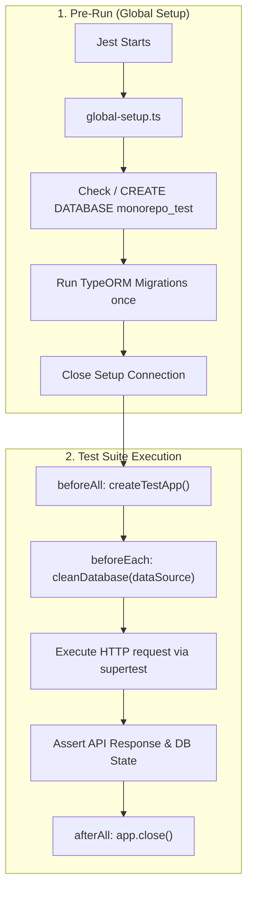

# E2E & Integration Testing Architecture

> **English** | [Tiếng Việt](../vi/TESTING.md)

This document describes the End-to-End (E2E) and integration testing architecture for the NestJS API application (`apps/api`).

---

## Table of Contents

- [Overview](#overview)
- [Key Features](#key-features)
- [Architecture & Workflow](#architecture--workflow)
- [Environment Configuration (`.env.testing`)](#environment-configuration-envtesting)
- [Global Setup (`global-setup.ts`)](#global-setup-global-setupts)
- [Database Isolation & Reset Strategy (`cleanDatabase`)](#database-isolation--reset-strategy-cleandatabase)
- [Test Application Harness (`createTestApp`)](#test-application-harness-createtestapp)
- [Authentication Helpers (`getAdminAuthToken`)](#authentication-helpers-getadminauthtoken)
- [Writing E2E Tests](#writing-e2e-tests)
- [Running Tests](#running-tests)

---

## Overview

The testing architecture provides isolated, reproducible, and fast End-to-End testing. Tests run against a dedicated PostgreSQL database (`monorepo_test`), ensuring that local development data is never contaminated or accidentally mutated.

```
apps/api/test/
├── .env.testing               # Test environment variables (loaded in test mode)
├── jest-e2e.json              # Jest E2E configuration with globalSetup
├── global-setup.ts            # Pre-test hook: ensures DB exists & runs migrations
├── test-utils.ts              # App bootstrap, TRUNCATE reset, auth seeders
├── app.e2e-spec.ts            # Core health & exception filter tests
└── activity-log.e2e-spec.ts   # Feature E2E test verifying audit logs & isolation
```

---

## Key Features

1. **Isolated Test Database**: Completely separate PostgreSQL database (`monorepo_test`), configured via `.env.testing`.
2. **One-Time Migration on Startup**: `global-setup.ts` connects to PostgreSQL, creates the database if it doesn't exist, and runs all TypeORM migrations once before any test suites run.
3. **Sub-second Fresh Database Reset**: Instead of dropping schemas or running migrations before each test, `cleanDatabase(dataSource)` executes `TRUNCATE TABLE ... RESTART IDENTITY CASCADE` across all domain tables. Each reset takes $\approx 5\text{ms}$.
4. **Production-Parity App Harness**: `createTestApp()` applies the identical global configuration as `main.ts` (URI versioning `v1`, global prefix `/api`, `ValidationPipe` with whitelist and transformation, `ClassSerializerInterceptor`, and `GlobalExceptionFilter`).
5. **Strict Environment Enforcement**: Uses `NODE_ENV=test` matching `Environment.TEST = 'test'`.

---

## Architecture & Workflow



---

## Environment Configuration (`.env.testing`)

Located at `apps/api/.env.testing`:

```env
NODE_ENV=test
PORT=3001
APP_LOG_LEVEL=warn

DATABASE_HOST=localhost
DATABASE_PORT=5432
DATABASE_USERNAME=postgres
DATABASE_PASSWORD=postgres
DATABASE_NAME=monorepo_test
DATABASE_SSL_ENABLED=false

REDIS_HOST=localhost
REDIS_PORT=6379
REDIS_PASSWORD=

JWT_SECRET=super_secret_jwt_key_for_testing_purposes_only_min_32_chars
JWT_EXPIRES_IN=1h
```

In `app.module.ts`, `.env.testing` is prioritized when `process.env.NODE_ENV === Environment.TEST`:

```typescript
ConfigModule.forRoot({
  isGlobal: true,
  load: [...],
  envFilePath:
    process.env.NODE_ENV === Environment.TEST
      ? ['.env.testing', '.env']
      : ['.env'],
}),
```

---

## Global Setup (`global-setup.ts`)

Jest invokes `test/global-setup.ts` before any worker processes start:

```typescript
export default async function globalSetup(): Promise<void> {
  // 1. Connect to postgres default DB and ensure monorepo_test exists
  const client = new Client({ ... });
  await client.connect();
  const dbCheck = await client.query(
    `SELECT 1 FROM pg_database WHERE datname = $1;`,
    [dbName],
  );
  if (dbCheck.rowCount === 0) {
    await client.query(`CREATE DATABASE "${dbName}";`);
  }
  await client.end();

  // 2. Initialize AppDataSource pointing to monorepo_test and execute migrations
  await AppDataSource.initialize();
  await AppDataSource.runMigrations();
  await AppDataSource.destroy();
}
```

---

## Database Isolation & Reset Strategy (`cleanDatabase`)

To ensure each test starts with a clean database without paying the high cost of schema drop and migration execution, `cleanDatabase` queries all user tables and runs a single atomic `TRUNCATE`:

```typescript
export async function cleanDatabase(dataSource: DataSource): Promise<void> {
  const queryRunner = dataSource.createQueryRunner();
  try {
    const tables: Array<{ tablename: string }> = await queryRunner.query(
      `SELECT tablename FROM pg_tables WHERE schemaname = 'public' AND tablename NOT IN ('migrations', 'typeorm_metadata');`,
    );

    if (tables.length > 0) {
      const tableList = tables.map((t) => `"${t.tablename}"`).join(", ");
      await queryRunner.query(
        `TRUNCATE TABLE ${tableList} RESTART IDENTITY CASCADE;`,
      );
    }
  } finally {
    await queryRunner.release();
  }
}
```

Benefits:

- Resets all primary key identity sequences back to `1`.
- Honors foreign keys via `CASCADE`.
- Preserves the `migrations` and `typeorm_metadata` tables.
- Executes in under 10 milliseconds.

---

## Test Application Harness (`createTestApp`)

Creates a fully initialized NestJS testing application with production pipes, interceptors, and filters:

```typescript
export async function createTestApp(): Promise<INestApplication> {
  const moduleFixture: TestingModule = await Test.createTestingModule({
    imports: [AppModule],
  }).compile();

  const app = moduleFixture.createNestApplication({ bufferLogs: true });

  app.setGlobalPrefix("api");
  app.enableVersioning({
    type: VersioningType.URI,
    defaultVersion: "1",
  });

  app.useGlobalFilters(new GlobalExceptionFilter(app.get(Reflector)));
  app.useGlobalPipes(
    new ValidationPipe({
      whitelist: true,
      transform: true,
      forbidNonWhitelisted: true,
      transformOptions: { enableImplicitConversion: true },
    }),
  );
  app.useGlobalInterceptors(new ClassSerializerInterceptor(app.get(Reflector)));

  await app.init();
  return app;
}
```

---

## Authentication Helpers (`getAdminAuthToken`)

Seeds necessary admin records, roles, permissions, and active sessions directly in `monorepo_test`, then signs a valid JWT token:

```typescript
export async function getAdminAuthToken(
  app: INestApplication,
  overrideData?: { email?: string; permissions?: string[] },
): Promise<{ token: string; admin: AdminEntity }>;
```

---

## Writing E2E Tests

Example from `test/activity-log.e2e-spec.ts`:

```typescript
describe("Activity Log (E2E)", () => {
  let app: INestApplication;
  let dataSource: DataSource;
  let adminToken: string;

  beforeAll(async () => {
    app = await createTestApp();
    dataSource = app.get<DataSource>(DataSource);
  });

  afterAll(async () => {
    await app.close();
  });

  beforeEach(async () => {
    await cleanDatabase(dataSource);
    const auth = await getAdminAuthToken(app, {
      permissions: ["read:AUDIT_LOG", "create:ROLE", "read:ROLE"],
    });
    adminToken = auth.token;
  });

  it("should create an activity log when a role is created", async () => {
    const res = await request(app.getHttpServer())
      .post("/api/v1/admin/roles")
      .set("Authorization", `Bearer ${adminToken}`)
      .send({
        name: "Manager",
        description: "Store manager",
        permissionIds: ["..."],
      })
      .expect(201);

    const logRes = await request(app.getHttpServer())
      .get("/api/v1/activity-logs")
      .set("Authorization", `Bearer ${adminToken}`)
      .expect(200);

    expect(logRes.body.data.items.length).toBeGreaterThan(0);
  });
});
```

---

## Running Tests

Run E2E tests:

```bash
# Run from repository root
pnpm --filter api test:e2e

# Or from apps/api
pnpm test:e2e
```

Run unit tests:

```bash
pnpm --filter api test
```
