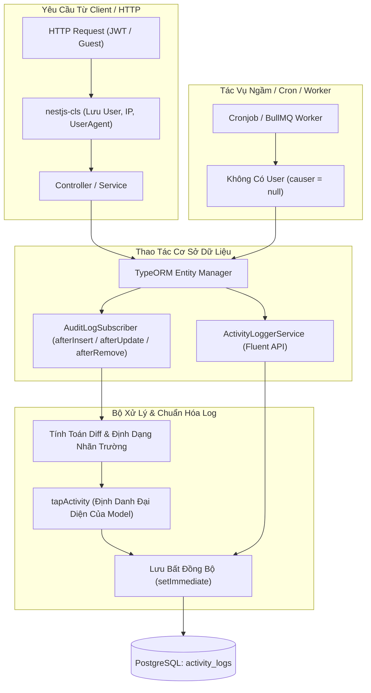

# Hệ Thống Activity & Audit Log Cho NestJS & TypeORM

> [English](../en/ACTIVITY_LOG.md) | **Tiếng Việt**

Kiến trúc ghi nhận nhật ký hoạt động (Activity & Audit Log) tự động và linh hoạt dành cho NestJS và TypeORM.

Hệ thống cho phép tự động theo dõi biến động dữ liệu trên các TypeORM entity, tính toán diff chi tiết từng trường, tự động giải quyết ngữ cảnh người thực hiện (actor context) qua Continuation Local Storage (`nestjs-cls`), đồng thời cung cấp giao diện Fluent Builder trực quan để ghi nhận log thủ công trong các nghiệp vụ tuỳ biến.

---

## Mục Lục

- [Tính Năng Nổi Bật](#tính-năng-nổi-bật)
- [Tổng Quan Kiến Trúc](#tổng-quan-kiến-trúc)
- [Cấu Trúc Thư Mục](#cấu-trúc-thư-mục)
- [Cơ Sở Dữ Liệu & Entity](#cơ-sở-dữ-liệu--entity)
  - [Định Nghĩa Entity (`ActivityLogEntity`)](#định-nghĩa-entity-activitylogentity)
  - [Hệ Thống Chỉ Mục (Indexes)](#hệ-thống-chỉ-mục-indexes)
- [Theo Dõi Tự Động (`AuditLogSubscriber`)](#theo-dõi-tự-động-auditlogsubscriber)
  - [Vòng Đời Entity (Lifecycle Hooks)](#vòng-đời-entity-lifecycle-hooks)
  - [Trích Xuất Người Dùng & Ngữ Cảnh (CLS)](#trích-xuất-người-dùng--ngữ-cảnh-cls)
  - [Entity Bỏ Qua & Trường Nhạy Cảm](#entity-bỏ-qua--trường-nhạy-cảm)
  - [Bỏ Qua Dữ Liệu Không Đổi (`dontLogEmptyChanges`)](#bỏ-qua-dữ-liệu-không-đổi-dontlogemptychanges)
  - [Chuẩn Hóa Nhãn Trường Động (Dynamic Field Formatting)](#chuẩn-hóa-nhãn-trường-động-dynamic-field-formatting)
  - [Định Danh Model Mặc Định & Tap Activity](#định-danh-model-mặc-định--tap-activity)
- [Tùy Biến Cho Entity (`ILogsActivity`)](#tùy-biến-cho-entity-ilogsactivity)
  - [Cấu Hình `getActivitylogOptions()`](#cấu-hình-getactivitylogoptions)
  - [Can Thiệp Dữ Liệu Với `tapActivity()`](#can-thiệp-dữ-liệu-với-tapactivity)
- [Ghi Log Thủ Công Bằng Code (`ActivityLoggerService`)](#ghi-log-thủ-công-bằng-code-activityloggerservice)
  - [Fluent Builder API](#fluent-builder-api)
  - [Ví Dụ Thực Tế](#ví-dụ-thực-tế)
- [REST API & Khả Năng Tương Thích Ngược](#rest-api--khả-năng-tương-thích-ngược)
  - [Danh Sách Endpoint](#danh-sách-endpoint)
  - [Lọc Dữ Liệu & Phân Trang](#lọc-dữ-liệu--phân-trang)
  - [Response DTO & Bí Danh (Aliases)](#response-dto--bí-danh-aliases)
- [Tự Động Thu Dọn Dữ Liệu Cũ (Retention Policy)](#tự-động-thu-dọn-dữ-liệu-cũ-retention-policy)
- [Kiểm Thử (Unit Tests)](#kiểm-thử-unit-tests)

---

## Tính Năng Nổi Bật

- **Chuẩn Hóa Bộ Schema Hoạt Động**: Sử dụng toàn bộ bộ schema chuẩn (`logName`, `description`, `subjectType`, `subjectId`, `causerType`, `causerId`, `properties`, `event`, `batchUuid`).
- **Ghi Log Hai Chế Độ Độc Lập**:
  1. **Tự Động Theo Vòng Đời Entity**: TypeORM `EventSubscriber` tự động bắt các sự kiện thêm (`INSERT`), sửa (`UPDATE`), xóa (`DELETE`), xóa mềm (`SOFT_DELETE`), khôi phục (`RESTORE`) mà không cần can thiệp logic service.
  2. **Ghi Nhận Thủ Công (Fluent API)**: `ActivityLoggerService` cho phép ghi nhận các nghiệp vụ tùy ý, quy trình thanh toán, đăng nhập, export file hay các tác vụ theo lô (batch).
- **Nhận Diện Tác Nhân Tự Động Qua CLS**: Tự động giải quyết user thực hiện, IP client, User-Agent và Request ID thông qua `nestjs-cls` (AsyncLocalStorage); tự động fallback về `'System'` đối với các tác vụ chạy ngầm như cronjob, BullMQ worker hoặc khách vãng lai.
- **Loại Bỏ Log Rác (`dontLogEmptyChanges`)**: Tự động bỏ qua việc lưu log khi lệnh update không làm thay đổi giá trị thực tế của các trường.
- **Diff Chi Tiết Kèm Định Dạng Nhãn Động**: Ghi nhận mảng `{ field, label, from, to }` với cơ chế tự động chuyển `camelCase` / `snake_case` thành Title Case (ví dụ: `firstName` $\rightarrow$ `First Name`), triệt tiêu việc phải duy trì từ điển dịch tĩnh trong code backend.
- **Dễ Dàng Mở Rộng Cho Từng Entity**: Các entity chỉ cần implement interface `ILogsActivity` để cấu hình danh sách trường cần log, trường loại trừ, hoặc viết riêng hàm `tapActivity` định dạng mô tả theo nhu cầu.
- **Tương Thích Ngược 100% Với Frontend**: DTO phản hồi trả về cả các trường activity log chuẩn hóa lẫn các bí danh cũ (`entity`, `action`, `userId`, `oldValue`, `newValue`, `metadata`), giúp các ứng dụng client/admin hiện tại hoạt động trơn tru không lỗi.

---

## Tổng Quan Kiến Trúc



---

## Cấu Trúc Thư Mục

Toàn bộ module activity/audit log được đặt tại [`apps/api/src/api/audit-log/`](file:///home/hongphat/Documents/Personal/monorepo/apps/api/src/api/audit-log/):

```
apps/api/src/api/audit-log/
├── activity-logger.service.ts       # Service ghi log thủ công qua Fluent Builder
├── activity-logger.service.spec.ts  # Unit tests cho ActivityLoggerService
├── audit-log.controller.ts          # REST controller (/audit-logs và /activity-logs)
├── audit-log.controller.spec.ts     # Unit tests cho controller
├── audit-log.module.ts              # Khai báo module trong NestJS
├── audit-log.service.ts             # Service truy vấn phân trang & cron dọn dẹp
├── audit-log.service.spec.ts        # Unit tests cho service
├── dto/
│   └── audit-log.res.dto.ts         # DTO phản hồi (kết hợp schema chuẩn + Alias tương thích)
├── entities/
│   └── activity-log.entity.ts       # TypeORM Entity ánh xạ bảng activity_logs
├── interfaces/
│   └── logs-activity.interface.ts   # Interface ILogsActivity & LogOptions
└── subscribers/
    ├── audit-log.subscriber.ts      # TypeORM EventSubscriber tự động bắt thay đổi
    └── audit-log.subscriber.spec.ts # Bộ kiểm thử cho subscriber
```

---

## Cơ Sở Dữ Liệu & Entity

### Định Nghĩa Entity (`ActivityLogEntity`)

Bảng: `activity_logs`

| Cột            | Kiểu          | Cho Phép Null | Mô Tả                                                                               |
| :------------- | :------------ | :-----------: | :---------------------------------------------------------------------------------- |
| `id`           | `bigint`      |     Không     | Khóa chính tự động tăng (Auto-increment ID)                                         |
| `log_name`     | `varchar`     |     Không     | Kênh hoặc nhóm log (mặc định: `'default'`)                                          |
| `description`  | `text`        |      Có       | Mô tả ngắn gọn của hành động (`"{Model}: {identifier}"`)                            |
| `subject_type` | `varchar`     |      Có       | Tên entity hoặc model bị tác động (ví dụ: `'AdminUser'`, `'CmsPage'`)               |
| `subject_id`   | `bigint`      |      Có       | Khóa chính của bản ghi bị tác động                                                  |
| `causer_type`  | `varchar`     |      Có       | Loại đối tượng thực hiện (ví dụ: `'AdminUserEntity'`, `null` cho System)            |
| `causer_id`    | `varchar`     |      Có       | Định danh hoặc ID của người thực hiện                                               |
| `properties`   | `json`        |      Có       | Chứa `{ attributes, old, changedFields, changes, causer_name, ip, userAgent, ... }` |
| `event`        | `varchar`     |      Có       | Loại sự kiện (`'create'`, `'update'`, `'delete'`, `'restore'`)                      |
| `batch_uuid`   | `uuid`        |      Có       | UUID nhóm các hành động liên quan trong cùng một batch                              |
| `created_at`   | `timestamptz` |     Không     | Thời gian tạo (mặc định: `now()`)                                                   |
| `updated_at`   | `timestamptz` |     Không     | Thời gian cập nhật (mặc định: `now()`)                                              |

### Hệ Thống Chỉ Mục (Indexes)

Nhằm tối ưu hóa tốc độ truy vấn và phân trang:

- `IDX_activity_logs_log_name` trên `(log_name)`
- `IDX_activity_logs_subject` trên `(subject_type, subject_id)`
- `IDX_activity_logs_causer` trên `(causer_type, causer_id)`
- `IDX_activity_logs_event` trên `(event)`
- `IDX_activity_logs_batch_uuid` trên `(batch_uuid)`
- `IDX_activity_logs_created_at` trên `(created_at)`

---

## Theo Dõi Tự Động (`AuditLogSubscriber`)

Lớp [`AuditLogSubscriber`](file:///home/hongphat/Documents/Personal/monorepo/apps/api/src/api/audit-log/subscribers/audit-log.subscriber.ts) lắng nghe toàn bộ các thao tác dữ liệu qua TypeORM:

### Vòng Đời Entity (Lifecycle Hooks)

- `afterInsert(event)`: Tạo log với sự kiện `'create'`.
- `afterUpdate(event)`: Tính toán diff thay đổi; tạo log sự kiện `'update'`.
- `afterRemove(event)`: Tạo log với sự kiện `'delete'`.
- `afterSoftRemove(event)`: Tạo log với sự kiện `'delete'`.
- `afterRecover(event)`: Tạo log với sự kiện `'restore'`.

Hành động lưu log được đưa vào hàng đợi bất đồng bộ thông qua `setImmediate(() => auditRepo.save(log))` để đảm bảo **không làm tăng thời gian phản hồi (latency)** của API chính.

### Trích Xuất Người Dùng & Ngữ Cảnh (CLS)

Subscriber tự động lấy thông tin từ request context của `nestjs-cls`:

```typescript
const cls = ClsServiceManager.getClsService();
const currentUser = cls.get("user");
const causerId = currentUser?.id ? String(currentUser.id) : null;
const rawUserType = cls.get("userType");
const causerType = causerId ? rawUserType || "AdminUserEntity" : null;
```

- **Người dùng đã đăng nhập**: Tự động gán `causerId`, `causerType` và tên người thực hiện `actorName` (`fullName` hoặc `firstName lastName` hoặc `email`).
- **Tác vụ hệ thống / Cronjob / Worker / Khách**: Khi không có `causerId`, `causerType` sẽ là `null` và `properties.causer_name` được đặt là `'System'`. **Không bao giờ bị sót log.**

### Entity Bỏ Qua & Trường Nhạy Cảm

Các bảng sau được loại trừ tự động để tránh đệ quy và tràn bộ nhớ:

- `ActivityLogEntity` (và `AuditLogEntity`)
- `AdminSessionEntity`
- `UserSessionEntity`
- `EmailLogEntity`

Các trường bảo mật nhạy cảm luôn được tự động loại bỏ khỏi `attributes` và `old`:

- `password`, `previousPassword`, `twoFactorSecret`, `twoFactorBackupCodes`, `hash`, `token`, `salt`, `rememberToken`, `remember_token`.

### Bỏ Qua Dữ Liệu Không Đổi (`dontLogEmptyChanges`)

Khi xảy ra hành động cập nhật nhưng không có trường nghiệp vụ nào thay đổi giá trị thực tế (ví dụ: touch timestamp hoặc lưu lại giá trị y hệt cũ), subscriber sẽ bỏ qua không tạo bản ghi log:

```typescript
if (
  action === "UPDATE" &&
  options.dontLogEmptyChanges !== false &&
  changedFields.length === 0
) {
  return;
}
```

### Chuẩn Hóa Nhãn Trường Động (Dynamic Field Formatting)

Nhãn hiển thị của các cột trong mảng `changes` được chuyển đổi tự động bằng hàm `formatFieldLabel(key)`. Cơ chế này loại bỏ hoàn toàn nhu cầu phải khai báo dictionary tĩnh:

| Tên Trường (Key)   | Nhãn Hiển Thị (Label) |
| :----------------- | :-------------------- |
| `firstName`        | `First Name`          |
| `twoFactorEnabled` | `Two Factor Enabled`  |
| `brand_name`       | `Brand Name`          |
| `is_active`        | `Is Active`           |

### Định Danh Model Mặc Định & Tap Activity

Hàm `tapActivity` mặc định tự động tìm trường định danh trực quan của từng Model:

```typescript
private resolveModelKey(modelBaseName: string): string {
  const keyMap: Record<string, string> = {
    AdminUser: 'fullName',
    User: 'fullName',
    Member: 'fullName',
    AdminRole: 'name',
    Role: 'name',
    AdminPermission: 'name',
    Permission: 'name',
    CmsPage: 'title',
    CmsPageTranslation: 'title',
    WhiteLabel: 'brandName',
    File: 'originalName',
    FileFolder: 'name',
    Setting: 'key',
  };
  return keyMap[modelBaseName] || 'id';
}
```

Mô tả được tạo ra có cấu trúc rõ ràng:

- `AdminUser: John Doe`
- `AdminRole: Super Administrator`
- `CmsPage: Điều Khoản Dịch Vụ`

---

## Tùy Biến Cho Entity (`ILogsActivity`)

Bất kỳ entity nào cũng có thể tinh chỉnh hành vi ghi log bằng cách cài đặt interface [`ILogsActivity`](file:///home/hongphat/Documents/Personal/monorepo/apps/api/src/api/audit-log/interfaces/logs-activity.interface.ts).

### Cấu Hình `getActivitylogOptions()`

```typescript
import {
  ILogsActivity,
  LogOptions,
} from "../audit-log/interfaces/logs-activity.interface";

@Entity("products")
export class ProductEntity implements ILogsActivity {
  @PrimaryGeneratedColumn()
  id: number;

  @Column()
  name: string;

  @Column()
  sku: string;

  @Column({ nullable: true })
  internalNotes: string;

  getActivitylogOptions(): LogOptions {
    return {
      logAll: true,
      dontLogEmptyChanges: true,
      logExcept: ["internalNotes"], // Loại trừ ghi chú nội bộ khỏi log
    };
  }
}
```

### Can Thiệp Dữ Liệu Với `tapActivity()`

Cho phép entity tự định dạng mô tả hoặc bổ sung metadata riêng:

```typescript
@Entity("orders")
export class OrderEntity implements ILogsActivity {
  @PrimaryGeneratedColumn()
  id: number;

  @Column()
  orderCode: string;

  @Column()
  totalAmount: number;

  tapActivity(activity: ActivityLogEntity, eventName: string): void {
    activity.description = `Đơn hàng #${this.orderCode} vừa được ${eventName}`;
    if (!activity.properties) activity.properties = {};
    activity.properties.currency = "VND";
  }
}
```

---

## Ghi Log Thủ Công Bằng Code (`ActivityLoggerService`)

Dành cho các hành vi không gắn liền trực tiếp với ORM (như Đăng nhập, Reset mật khẩu, Export báo cáo, Đồng bộ cài đặt), sử dụng fluent service [`ActivityLoggerService`](file:///home/hongphat/Documents/Personal/monorepo/apps/api/src/api/audit-log/activity-logger.service.ts).

### Fluent Builder API

| Phương Thức                     | Ý Nghĩa                                                        |
| :------------------------------ | :------------------------------------------------------------- |
| `useLog(logName: string)`       | Đặt kênh log (ví dụ: `'auth'`, `'export'`, `'payment'`)        |
| `event(event: string)`          | Đặt tên sự kiện (ví dụ: `'login'`, `'export'`)                 |
| `performedOn(subject: any)`     | Thiết lập đối tượng bị tác động (`subjectType` và `subjectId`) |
| `causedBy(causer: any)`         | Chỉ định đối tượng thực hiện hành động                         |
| `withBatch(uuid: string)`       | Gắn kèm UUID theo lô để gom nhóm                               |
| `withProperties(props: object)` | Bổ sung metadata tùy ý vào JSON `properties`                   |
| `log(description: string)`      | Ghi log vào database và trả về thực thể `ActivityLogEntity`    |

### Ví Dụ Thực Tế

#### 1. Ghi Nhận Đăng Nhập Người Dùng

```typescript
@Injectable()
export class AuthService {
  constructor(private readonly activityLogger: ActivityLoggerService) {}

  async login(user: AdminUserEntity, ip: string, userAgent: string) {
    // Xác thực tài khoản...

    await this.activityLogger
      .useLog("auth")
      .event("login")
      .causedBy(user)
      .performedOn(user)
      .withProperties({ ip, userAgent, method: "password" })
      .log(`Người dùng ${user.email} đăng nhập thành công`);
  }
}
```

#### 2. Ghi Nhận Tác Vụ Xuất Dữ Liệu Hàng Loạt

```typescript
const batchUuid = crypto.randomUUID();

await this.activityLogger
  .useLog("export")
  .event("export")
  .withBatch(batchUuid)
  .withProperties({ format: "csv", recordCount: 1500 })
  .log("Xuất báo cáo danh sách khách hàng");
```

---

## REST API & Khả Năng Tương Thích Ngược

### Danh Sách Endpoint

Được bảo vệ bởi `AdminAuthGuard` và `PoliciesGuard` (`AppActions.Read, AppSubjects.Log`):

- `GET /api/v1/audit-logs` hoặc `GET /api/v1/activity-logs`
- `GET /api/v1/audit-logs/:id` hoặc `GET /api/v1/activity-logs/:id`

### Lọc Dữ Liệu & Phân Trang

Tích hợp hoàn hảo với thư viện `nestjs-paginate`:

| Tham Số              | Kiểu             | Mô Tả                                                           |
| :------------------- | :--------------- | :-------------------------------------------------------------- |
| `page` / `limit`     | số nguyên        | Trang hiện tại và số lượng mỗi trang                            |
| `sortBy`             | chuỗi            | Cột sắp xếp (`createdAt`, `logName`, `event`, `id`)             |
| `filter.event`       | `$in` / `$eq`    | Lọc theo loại sự kiện (`create`, `update`, `delete`, `restore`) |
| `filter.logName`     | `$in` / `$eq`    | Lọc theo kênh log                                               |
| `filter.subjectType` | `$ilike` / `$eq` | Lọc theo entity bị tác động                                     |
| `filter.subjectId`   | `$eq`            | Lọc theo ID bản ghi                                             |
| `filter.causerId`    | `$eq`            | Lọc theo ID người thực hiện                                     |
| `filter.createdAt`   | `$gte` / `$lte`  | Lọc theo khoảng thời gian                                       |
| `search`             | chuỗi            | Tìm kiếm mờ (ILIKE) trên description, subject, causer, event    |

### Response DTO & Bí Danh (Aliases)

Lớp [`AuditLogResDto`](file:///home/hongphat/Documents/Personal/monorepo/apps/api/src/api/audit-log/dto/audit-log.res.dto.ts) vừa xuất các trường activity log chuẩn hóa vừa ánh xạ các bí danh tương thích cho frontend cũ:

```json
{
  "id": "104",
  "logName": "default",
  "description": "AdminRole: Manager",
  "subjectType": "AdminRoleEntity",
  "subjectId": "3",
  "causerType": "AdminUserEntity",
  "causerId": "1",
  "event": "update",
  "properties": {
    "causer_name": "Admin User",
    "changedFields": ["name"],
    "changes": [
      {
        "field": "name",
        "label": "Name",
        "from": "Old Manager",
        "to": "Manager"
      }
    ],
    "ip": "127.0.0.1",
    "userAgent": "Mozilla/5.0"
  },
  "createdAt": "2026-10-15T09:00:00.000Z",
  "updatedAt": "2026-10-15T09:00:00.000Z",

  // Các trường bí danh tương thích với frontend cũ
  "entity": "AdminRoleEntity",
  "entityId": "3",
  "action": "update",
  "userId": "1",
  "changes": [
    {
      "field": "name",
      "label": "Name",
      "from": "Old Manager",
      "to": "Manager"
    }
  ],
  "timestamp": "2026-10-15T09:00:00.000Z"
}
```

---

## Tự Động Thu Dọn Dữ Liệu Cũ (Retention Policy)

[`AuditLogService`](file:///home/hongphat/Documents/Personal/monorepo/apps/api/src/api/audit-log/audit-log.service.ts) định kỳ dọn dẹp các bản ghi quá 7 ngày để tối ưu dung lượng đĩa:

```typescript
@Cron(CronExpression.EVERY_DAY_AT_10AM)
async purgeAuditLogsOlderThan7Days() {
  const sevenDaysAgo = new Date(Date.now() - 7 * 24 * 60 * 60 * 1000);
  await this.auditLogRepository.delete({ createdAt: LessThan(sevenDaysAgo) });
}
```

---

## Kiểm Thử (Unit Tests)

Bộ unit test hoàn chỉnh kiểm tra toàn bộ hoạt động của subscriber, bỏ qua log rỗng, định dạng nhãn động, ghi nhận tác nhân System, và fluent service:

```bash
# Chạy bộ test cho audit-log
pnpm --filter api test apps/api/src/api/audit-log
```

Kết quả:

```text
PASS src/api/audit-log/subscribers/audit-log.subscriber.spec.ts
PASS src/api/audit-log/activity-logger.service.spec.ts
PASS src/api/audit-log/audit-log.service.spec.ts
PASS src/api/audit-log/audit-log.controller.spec.ts

Test Suites: 4 passed, 4 total
Tests:       17 passed, 17 total
```
