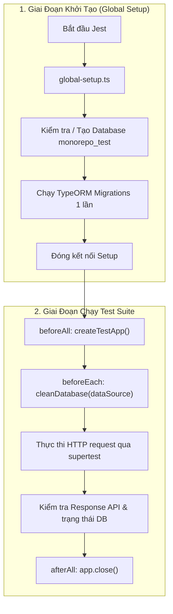

# Kiến Trúc Kiểm Thử E2E & Tích Hợp (Testing Architecture)

> [English](../en/TESTING.md) | **Tiếng Việt**

Tài liệu này mô tả chi tiết kiến trúc kiểm thử End-to-End (E2E) và kiểm thử tích hợp (integration testing) cho ứng dụng backend NestJS (`apps/api`).

---

## Mục Lục

- [Tổng Quan](#tổng-quan)
- [Tính Năng Nổi Bật](#tính-năng-nổi-bật)
- [Luồng Hoạt Động & Kiến Trúc](#luồng-hoạt-động--kiến-trúc)
- [Cấu Hình Môi Trường (`.env.testing`)](#cấu-hình-môi-trường-envtesting)
- [Khởi Tạo Toàn Cục (`global-setup.ts`)](#khởi-tạo-toàn-cục-global-setupts)
- [Chiến Lược Làm Sạch Database Cực Nhanh (`cleanDatabase`)](#chiến-lược-làm-sạch-database-cực-nhanh-cleandatabase)
- [Harness Khởi Tạo Ứng Dụng Test (`createTestApp`)](#harness-khởi-tạo-ứng-dụng-test-createtestapp)
- [Hàm Tiện Ích Xác Thực Admin (`getAdminAuthToken`)](#hàm-tiện-ích-xác-thực-admin-getadminauthtoken)
- [Cách Viết Test Suite E2E](#cách-viết-test-suite-e2e)
- [Lệnh Chạy Test](#lệnh-chạy-test)

---

## Tổng Quan

Kiến trúc kiểm thử E2E được thiết kế nhằm đảm bảo tính cô lập tuyệt đối, tốc độ thực thi nhanh và không gây ảnh hưởng đến dữ liệu đang phát triển ở môi trường cục bộ (`development/local`). Tất cả các bài test E2E đều chạy trên một cơ sở dữ liệu PostgreSQL độc lập mang tên `monorepo_test`.

```
apps/api/test/
├── .env.testing               # Cấu hình biến môi trường dành riêng cho testing
├── jest-e2e.json              # Cấu hình Jest E2E kèm globalSetup
├── global-setup.ts            # Hook chạy trước toàn bộ test: tạo DB & chạy migrations
├── test-utils.ts              # Harness khởi tạo app, dọn dẹp TRUNCATE, seed dữ liệu auth
├── app.e2e-spec.ts            # E2E test cho health check & bộ lọc ngoại lệ toàn cục
└── activity-log.e2e-spec.ts   # E2E test kiểm tra ghi log hoạt động & tính cô lập DB
```

---

## Tính Năng Nổi Bật

1. **Database Riêng Biệt Cho Test**: Toàn bộ dữ liệu kiểm thử được ghi vào `monorepo_test`, được khai báo rõ ràng trong `.env.testing`.
2. **Migration Chạy 1 Lần Duy Nhất**: Thay vì chạy lại migration ở từng file spec, `global-setup.ts` khởi tạo database và thực thi toàn bộ TypeORM migration đúng một lần trước khi Jest chạy các worker test.
3. **Làm Sạch Dữ Liệu Dưới 10ms (Fresh Database)**: Thay vì drop schema hoặc migrate lại rất tốn thời gian, hàm `cleanDatabase(dataSource)` thực hiện `TRUNCATE TABLE ... RESTART IDENTITY CASCADE` trên tất cả các bảng nghiệp vụ, đưa sequence ID tự tăng về lại `1` mà vẫn giữ nguyên bảng `migrations` và `typeorm_metadata`.
4. **Đồng Bộ Hoàn Toàn Cấu Hình Production**: `createTestApp()` thiết lập toàn bộ pipeline giống hệt `main.ts` (URI versioning `v1`, tiền tố toàn cục `/api`, `ValidationPipe` whitelist/transform, `ClassSerializerInterceptor`, và `GlobalExceptionFilter`).
5. **Quy Chuẩn Môi Trường Đồng Nhất**: Sử dụng chặt chẽ `NODE_ENV=test` tương ứng với `Environment.TEST = 'test'` trong mã nguồn.

---

## Luồng Hoạt Động & Kiến Trúc



---

## Cấu Hình Môi Trường (`.env.testing`)

Tệp cấu hình tại `apps/api/.env.testing`:

```env
NODE_ENV=test
PORT=3001
APP_LOG_LEVEL=warn

DATABASE_HOST=localhost
DATABASE_PORT=5432
DATABASE_USERNAME=postgres
DATABASE_PASSWORD=postgres
DATABASE_NAME=monorepo_test
DATABASE_SSL_ENABLED=false

REDIS_HOST=localhost
REDIS_PORT=6379
REDIS_PASSWORD=

JWT_SECRET=super_secret_jwt_key_for_testing_purposes_only_min_32_chars
JWT_EXPIRES_IN=1h
```

Trong `app.module.ts`, tệp `.env.testing` sẽ được ưu tiên tải trước khi `process.env.NODE_ENV === Environment.TEST`:

```typescript
ConfigModule.forRoot({
  isGlobal: true,
  load: [...],
  envFilePath:
    process.env.NODE_ENV === Environment.TEST
      ? ['.env.testing', '.env']
      : ['.env'],
}),
```

---

## Khởi Tạo Toàn Cục (`global-setup.ts`)

Jest kích hoạt `test/global-setup.ts` trước bất kỳ file test nào:

```typescript
export default async function globalSetup(): Promise<void> {
  // 1. Kết nối postgres mặc định để đảm bảo monorepo_test đã được tạo
  const client = new Client({ ... });
  await client.connect();
  const dbCheck = await client.query(
    `SELECT 1 FROM pg_database WHERE datname = $1;`,
    [dbName],
  );
  if (dbCheck.rowCount === 0) {
    await client.query(`CREATE DATABASE "${dbName}";`);
  }
  await client.end();

  // 2. Khởi tạo AppDataSource trỏ vào monorepo_test và chạy migrations
  await AppDataSource.initialize();
  await AppDataSource.runMigrations();
  await AppDataSource.destroy();
}
```

---

## Chiến Lược Làm Sạch Database Cực Nhanh (`cleanDatabase`)

Để mỗi test case bắt đầu trên một cơ sở dữ liệu sạch mà không phải chịu chi phí tái tạo schema, `cleanDatabase` thực hiện lệnh `TRUNCATE` nguyên tử:

```typescript
export async function cleanDatabase(dataSource: DataSource): Promise<void> {
  const queryRunner = dataSource.createQueryRunner();
  try {
    const tables: Array<{ tablename: string }> = await queryRunner.query(
      `SELECT tablename FROM pg_tables WHERE schemaname = 'public' AND tablename NOT IN ('migrations', 'typeorm_metadata');`,
    );

    if (tables.length > 0) {
      const tableList = tables.map((t) => `"${t.tablename}"`).join(", ");
      await queryRunner.query(
        `TRUNCATE TABLE ${tableList} RESTART IDENTITY CASCADE;`,
      );
    }
  } finally {
    await queryRunner.release();
  }
}
```

Ưu điểm:

- Khôi phục tất cả sequence khóa chính tự tăng về lại `1`.
- Tự động cascade qua các khóa ngoại (foreign key).
- Giữ nguyên cấu trúc bảng và lịch sử migrations.
- Tốc độ thực thi cực nhanh (~5 miligiây).

---

## Harness Khởi Tạo Ứng Dụng Test (`createTestApp`)

Hàm tạo ứng dụng NestJS môi trường kiểm thử với đầy đủ middleware, pipe và filter của môi trường chạy thật:

```typescript
export async function createTestApp(): Promise<INestApplication> {
  const moduleFixture: TestingModule = await Test.createTestingModule({
    imports: [AppModule],
  }).compile();

  const app = moduleFixture.createNestApplication({ bufferLogs: true });

  app.setGlobalPrefix("api");
  app.enableVersioning({
    type: VersioningType.URI,
    defaultVersion: "1",
  });

  app.useGlobalFilters(new GlobalExceptionFilter(app.get(Reflector)));
  app.useGlobalPipes(
    new ValidationPipe({
      whitelist: true,
      transform: true,
      forbidNonWhitelisted: true,
      transformOptions: { enableImplicitConversion: true },
    }),
  );
  app.useGlobalInterceptors(new ClassSerializerInterceptor(app.get(Reflector)));

  await app.init();
  return app;
}
```

---

## Hàm Tiện Ích Xác Thực Admin (`getAdminAuthToken`)

Tự động tạo admin giả lập, gán quyền và tạo active session trực tiếp vào `monorepo_test`, sau đó sinh JWT access token hợp lệ:

```typescript
export async function getAdminAuthToken(
  app: INestApplication,
  overrideData?: { email?: string; permissions?: string[] },
): Promise<{ token: string; admin: AdminEntity }>;
```

---

## Cách Viết Test Suite E2E

Ví dụ từ `test/activity-log.e2e-spec.ts`:

```typescript
describe("Activity Log (E2E)", () => {
  let app: INestApplication;
  let dataSource: DataSource;
  let adminToken: string;

  beforeAll(async () => {
    app = await createTestApp();
    dataSource = app.get<DataSource>(DataSource);
  });

  afterAll(async () => {
    await app.close();
  });

  beforeEach(async () => {
    await cleanDatabase(dataSource);
    const auth = await getAdminAuthToken(app, {
      permissions: ["read:AUDIT_LOG", "create:ROLE", "read:ROLE"],
    });
    adminToken = auth.token;
  });

  it("phải tạo bản ghi activity log khi tạo mới role", async () => {
    const res = await request(app.getHttpServer())
      .post("/api/v1/admin/roles")
      .set("Authorization", `Bearer ${adminToken}`)
      .send({
        name: "Manager",
        description: "Store manager",
        permissionIds: ["..."],
      })
      .expect(201);

    const logRes = await request(app.getHttpServer())
      .get("/api/v1/activity-logs")
      .set("Authorization", `Bearer ${adminToken}`)
      .expect(200);

    expect(logRes.body.data.items.length).toBeGreaterThan(0);
  });
});
```

---

## Lệnh Chạy Test

Chạy E2E tests:

```bash
# Chạy từ thư mục gốc monorepo
pnpm --filter api test:e2e

# Hoặc chạy trong thư mục apps/api
pnpm test:e2e
```

Chạy unit tests:

```bash
pnpm --filter api test
```
